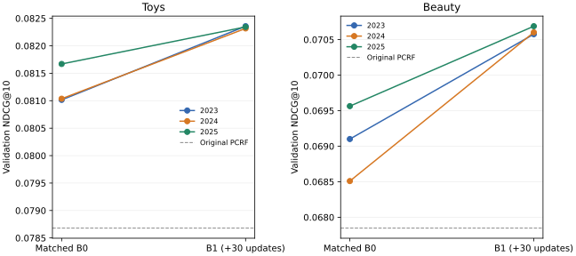

# Stage20 B1缓存复用多初始化验证：完成结果与下一步

**2026-09-16论文目标优先级修订：** 按用户“9月底冻结方法、优先找到可行且有贡献的方法”的要求，H0旧收益归因对照后置，当前KL扩展继续停止。B1＋PCRF保留为强基线；下一候选是条件参照下的协同增量排序修正，先比较强基线与同容量普通融合，有效再跨域。其创新性和效果尚未成立，新实验尚未启动。当前唯一资源顺序见[论文主线与9月底冻结计划](../../plan/第二十阶段/论文主线与九月底方法冻结计划_20260916.md)；下方早先的“下一步”建议保留为历史。

**结论：B1新增排序收益在这三个残差初始化上均保留，可以作为当前更强的排序基线和后续迁移教师。** Toys/Beauty各3/3个初始化的NDCG@10、Hit@10超过自己的冻结B0，也全部超过原PCRF；六组全量八指标相对B0均七升一平。下一步应进入生成器内部迁移的最小协议准备，无需继续扩展同一排序器的seed矩阵。

## Material Passport 与终态

- Origin Skill：academic-research-suite / experiment-agent；Origin Mode：validate / analyze。
- 分析日期：2026-09-13；状态：**COMPLETED**；证据等级：**ANALYZED**（独立缓存复算通过，并非完整模型独立重训）。
- 2026-09-13 14:53:27至15:05:24（北京时间），实际11分57秒，6/6任务退出码0，其中两项profile、四项新训练；新增120步残差更新，骨干/head更新0步，新增beam与CF打分0次，未读test。
- 2023 B1/B0是前轮已观察结果；本轮新增2024/2025。fit/calibration、候选、六维特征、PCRF和超参数固定，变化仅为残差起始checkpoint。不是父模型、C1或head的三seed复现。
- [冻结status](../../artifacts/phase20/gacr_b1_multiseed_v1/status.json)、[汇总summary](../../artifacts/phase20/gacr_b1_multiseed_v1/summary.json)、[配置](../../experiment/phase20/gacr_b1_multiseed_v1.json)、[前轮B1/B2报告](Stage20_固定候选最终融合训练进展与结果.md)。完成后心跳停止属于正常终态。

## 1. 三初始化主结果

以下是三初始化均值；百分比是相对变化，不是百分点。三seed平均不对应一个可直接部署的checkpoint，也没有做ensemble。

| 域 | B1平均N10 | 对B0均值 | 对原PCRF | B1平均H10 | 对B0均值 | 对原PCRF |
| --- | --- | --- | --- | --- | --- | --- |
| Toys | 0.082340 | +1.35% | +4.65% | 0.131053 | +0.98% | +4.65% |
| Beauty | 0.070622 | +2.27% | +4.09% | 0.117709 | +1.69% | +3.68% |

图中每条线连接同一个初始化的B0与B1；2023线复用前轮结果，不是本轮额外重训。

| 域 | 初始化 | B0 N10 | B1 N10 | ΔN10 | N10配对95%区间 | ΔH10 | H10配对95%区间 | Top10新增/丢失/净增 |
| --- | --- | --- | --- | --- | --- | --- | --- | --- |
| Toys | 2023 | 0.081016 | 0.082357 | +0.001342 | [+0.000960, +0.001735] | +0.001700 | [+0.000824, +0.002679] | 62/29/+33 |
| Toys | 2024 | 0.081037 | 0.082317 | +0.001281 | [+0.000889, +0.001690] | +0.001545 | [+0.000567, +0.002576] | 65/35/+30 |
| Toys | 2025 | 0.081669 | 0.082344 | +0.000675 | [+0.000339, +0.001028] | +0.000567 | [-0.000258, +0.001442] | 44/33/+11 |
| Beauty | 2023 | 0.069101 | 0.070576 | +0.001475 | [+0.001159, +0.001805] | +0.001968 | [+0.001207, +0.002728] | 61/17/+44 |
| Beauty | 2024 | 0.068509 | 0.070602 | +0.002093 | [+0.001726, +0.002443] | +0.002638 | [+0.001744, +0.003533] | 81/22/+59 |
| Beauty | 2025 | 0.069564 | 0.070688 | +0.001125 | [+0.000827, +0.001421] | +0.001252 | [+0.000492, +0.002012] | 51/23/+28 |

六个N10对B0的区间均在零以上；**Toys 2025的H10虽然净增11，但区间跨零**，不能称六个H10均得到相同强度的支持。所有六个B1对原PCRF的N10/H10区间在零以上；这些仍是反复开发validation上的探索性用户配对区间，未校正多重比较。

## 2. 全部八指标

N表示NDCG，H表示Hit。均值表同时保留raw残差排序和最终PCRF组合，避免只公布主指标。
### Toys

| 方法 | N5 | N10 | N20 | N50 | H5 | H10 | H20 | H50 |
| --- | --- | --- | --- | --- | --- | --- | --- | --- |
| 原PCRF | 0.068459 | 0.078679 | 0.088590 | 0.098094 | 0.093550 | 0.125232 | 0.164589 | 0.212085 |
| B0_raw三初始化均值 | 0.067918 | 0.077184 | 0.085828 | 0.096549 | 0.092503 | 0.121300 | 0.155574 | 0.209561 |
| B0三初始化均值 | 0.070820 | 0.081241 | 0.090117 | 0.099038 | 0.097551 | 0.129782 | 0.164881 | 0.209561 |
| B1_raw三初始化均值 | 0.068914 | 0.077973 | 0.086779 | 0.097206 | 0.094426 | 0.122570 | 0.157394 | 0.209561 |
| B1三初始化均值 | 0.072127 | 0.082340 | 0.091276 | 0.099924 | 0.099440 | 0.131053 | 0.166340 | 0.209561 |
| B1均值对原PCRF | +5.36% | +4.65% | +3.03% | +1.86% | +6.30% | +4.65% | +1.06% | -1.19% |

| 初始化/臂 | N5 | N10 | N20 | N50 | H5 | H10 | H20 | H50 |
| --- | --- | --- | --- | --- | --- | --- | --- | --- |
| 2023/B0 | 0.070555 | 0.081016 | 0.089878 | 0.098881 | 0.097053 | 0.129404 | 0.164434 | 0.209561 |
| 2023/B1 | 0.072162 | 0.082357 | 0.091271 | 0.099930 | 0.099526 | 0.131104 | 0.166289 | 0.209561 |
| 2024/B0 | 0.070833 | 0.081037 | 0.089936 | 0.098913 | 0.097826 | 0.129404 | 0.164589 | 0.209561 |
| 2024/B1 | 0.072143 | 0.082317 | 0.091290 | 0.099926 | 0.099475 | 0.130950 | 0.166392 | 0.209561 |
| 2025/B0 | 0.071072 | 0.081669 | 0.090536 | 0.099319 | 0.097775 | 0.130538 | 0.165619 | 0.209561 |
| 2025/B1 | 0.072075 | 0.082344 | 0.091267 | 0.099915 | 0.099320 | 0.131104 | 0.166340 | 0.209561 |

### Beauty

| 方法 | N5 | N10 | N20 | N50 | H5 | H10 | H20 | H50 |
| --- | --- | --- | --- | --- | --- | --- | --- | --- |
| 原PCRF | 0.057530 | 0.067847 | 0.077975 | 0.088802 | 0.081519 | 0.113536 | 0.153915 | 0.208156 |
| B0_raw三初始化均值 | 0.056651 | 0.067037 | 0.076543 | 0.087891 | 0.079775 | 0.111971 | 0.149667 | 0.206725 |
| B0三初始化均值 | 0.059033 | 0.069058 | 0.078790 | 0.089240 | 0.084589 | 0.115757 | 0.154422 | 0.206725 |
| B1_raw三初始化均值 | 0.057583 | 0.067917 | 0.077505 | 0.088643 | 0.080937 | 0.112954 | 0.150919 | 0.206725 |
| B1三初始化均值 | 0.060604 | 0.070622 | 0.080355 | 0.090464 | 0.086601 | 0.117709 | 0.156315 | 0.206725 |
| B1均值对原PCRF | +5.34% | +4.09% | +3.05% | +1.87% | +6.24% | +3.68% | +1.56% | -0.69% |

| 初始化/臂 | N5 | N10 | N20 | N50 | H5 | H10 | H20 | H50 |
| --- | --- | --- | --- | --- | --- | --- | --- | --- |
| 2023/B0 | 0.059175 | 0.069101 | 0.078874 | 0.089312 | 0.084783 | 0.115637 | 0.154452 | 0.206725 |
| 2023/B1 | 0.060594 | 0.070576 | 0.080318 | 0.090445 | 0.086616 | 0.117605 | 0.156240 | 0.206725 |
| 2024/B0 | 0.058441 | 0.068509 | 0.078231 | 0.088832 | 0.083710 | 0.115011 | 0.153647 | 0.206725 |
| 2024/B1 | 0.060654 | 0.070602 | 0.080357 | 0.090464 | 0.086750 | 0.117650 | 0.156330 | 0.206725 |
| 2025/B0 | 0.059483 | 0.069564 | 0.079266 | 0.089574 | 0.085275 | 0.116621 | 0.155167 | 0.206725 |
| 2025/B1 | 0.060564 | 0.070688 | 0.080390 | 0.090485 | 0.086437 | 0.117873 | 0.156374 | 0.206725 |

每个初始化的B1对自身B0都是N5/N10/N20/N50、H5/H10/H20提高，H50相同；三初始化均值对原PCRF为七升一降。候选仍是同一C1 50项，H50没有被新增训练修复：Toys/Beauty对原PCRF分别−1.19%/−0.69%，每个初始化均净少49/32个Top50命中。

raw残差的平均N10也从Toys 0.077184→0.077973、Beauty 0.067037→0.067917上升；最终PCRF继续提供互补收益。可以把这套继续训练配置纳入当前排序方法，但B0到B1同时包含额外训练、optimizer重置、固定候选拟合以及pairwise目标等变化，尚不能单独归因某一个因素。

## 3. 初始化间差异与分组例外

继续训练后的最终指标更接近。下面是三个初始化的样本标准差，仅作描述性比较，三点不足以证明对所有初始化稳定。

| 域 | 指标 | B0样本标准差 | B1样本标准差 | B1范围 |
| --- | --- | --- | --- | --- |
| Toys | ndcg@10 | 0.00037164 | 0.00002057 | [0.082317, 0.082357] |
| Toys | hit@10 | 0.00065432 | 0.00008923 | [0.130950, 0.131104] |
| Beauty | ndcg@10 | 0.00052856 | 0.00005876 | [0.070576, 0.070688] |
| Beauty | hit@10 | 0.00081150 | 0.00014374 | [0.117605, 0.117873] |

| 域 | 分组 | B1平均N10 | ΔN10对B0 | N10正增量 | B1平均H10 | ΔH10对B0 | H10正增量 | B1 H50 |
| --- | --- | --- | --- | --- | --- | --- | --- | --- |
| Toys | 低频目标 | 0.059854 | +0.000716 | 3/3 | 0.094574 | +0.000581 | 2/3 | 0.131008 |
| Toys | 较高频目标 | 0.090481 | +0.001238 | 3/3 | 0.144260 | +0.001520 | 3/3 | 0.238002 |
| Toys | C1训练用户外 | 0.082927 | +0.001232 | 3/3 | 0.131671 | +0.001488 | 3/3 | 0.210797 |
| Toys | C1训练用户内 | 0.080576 | +0.000699 | 3/3 | 0.129198 | +0.000618 | 2/3 | 0.205852 |
| Beauty | 低频目标 | 0.030608 | +0.001059 | 3/3 | 0.045682 | +0.000496 | 3/3 | 0.054224 |
| Beauty | 较高频目标 | 0.085459 | +0.001752 | 3/3 | 0.144416 | +0.002493 | 3/3 | 0.263271 |
| Beauty | C1训练用户外 | 0.069548 | +0.001541 | 3/3 | 0.116007 | +0.001948 | 3/3 | 0.205819 |
| Beauty | C1训练用户内 | 0.073845 | +0.001633 | 3/3 | 0.122816 | +0.001967 | 3/3 | 0.209444 |

所有分组的N10点估计均3/3为正。Toys 2025有两个H10例外：低频组净少2人（−0.000388），C1训练用户内组净少2人（−0.000412）；这两组可以重叠，不能相加当成4个不同用户。其低频N10及C1用户内N10区间也跨零。其余分组H10点估计为正，组均值不意味着每个用户受益。

低频组H50仍为Toys 0.131008、Beauty 0.054224，相对原PCRF下降5.45%/6.55%，净少39/23个命中。较高频组还净少10/9个。下一步涉及候选或生成器时，应直接观察这个覆盖缺口。评价低频阈值≤5/≤6，与训练前20%高频商品的head/tail权重定义不同；C1训练用户外不等同于整个项目从未训练过的用户。

## 4. 训练轨迹、缓存与复核

| 域 | 初始化 | 首步loss | 第30步loss | 26→30步下降 | 末步梯度范数 | 参数变化L2 |
| --- | --- | --- | --- | --- | --- | --- |
| Toys | 2023 | 0.462759 | 0.445831 | 0.000511 | 0.005683 | 1.6209 |
| Toys | 2024 | 0.466240 | 0.446569 | 0.000613 | 0.007137 | 1.9562 |
| Toys | 2025 | 0.458130 | 0.445487 | 0.000317 | 0.003655 | 1.6118 |
| Beauty | 2023 | 0.393976 | 0.373165 | 0.000654 | 0.007975 | 1.6782 |
| Beauty | 2024 | 0.400313 | 0.373807 | 0.001145 | 0.009201 | 1.7306 |
| Beauty | 2025 | 0.390361 | 0.373346 | 0.000211 | 0.013473 | 1.6720 |

各臂数值有限、权重更新，末段loss仍小幅下降；不能把最终指标接近写成已充分收敛。loss记录在对应更新前，checkpoint保留第30次更新后状态；没有逐步全量validation选模。

本轮复用两域48,837条训练缓存，candidate/CF评分均未重算；训练fit仍有Toys 9,440条、Beauty 12,417条正例在候选外，不参与pairwise损失，全部validation用户保留。真实GPU profile精确复现旧2023 B0/B1全量分数和排名，每个新seed训练前也精确对齐同seed B0；四项正式训练完成后监督器停止，没有自动启动内部化。

独立复核使用独立NumPy/标准库统计和评分排序，不导入实验训练实现：
- 1600项新运行分组指标、80组配对增量及四截断命中得失、320项三初始化聚合记录通过。
- 83,550条同seed基线用户记录精确对齐；167,100条用户×模型评分缓存独立重算PCRF/reliability，raw与最终rank完全一致。
- 4条新训练轨迹、checkpoint初始化与保存哈希、固定cohort及缓存哈希核对通过；71项配置源码哈希、46项域输入哈希、248项运行加载源码记录通过（记录跨域/seed有重复）。

[审计脚本](../../artifacts/phase20/review_20260913/verify_b1_multiseed_completion.py)、[机器可读复核结果](../../artifacts/phase20/review_20260913/b1_multiseed_completion_verification.json)。没有重新运行模型前向、optimizer或bootstrap区间；2023统计已由前轮独立复核，本次检查其文件哈希与聚合复用关系。

## 5. 下一步裁决

**排序阶段已得到值得保留的新增结果，可以准备向生成器迁移。** 不再追加同样的seed矩阵；先保留已有双域B1 seed2023 checkpoint作为统一教师版本，避免因Beauty 2025更高就事后按域挑选。三seed均值用于判断稳定性，不是teacher权重。

下一项建议是训练前缀上的完整候选列表蒸馏最小验证，先落实三件事，再固定预算启动：

1. **监督对象用真实50项完整商品列表。** 在现有合法训练前缀/C1候选缓存上用冻结B1＋PCRF输出教师分数；学生在同一列表上计算含EOS的完整商品序列log概率。按原生成评分规则明确长度处理，在每条历史的候选之间学习排序，包含不同父前缀的竞争，区别于旧PCPS的局部sibling代理。候选内蒸馏不能假定自然改善候选外召回。
2. **先验证继续训练能否保留父模型能力。** 固定学生起点和训练前缀/有效batch，先量出完整序列打分与梯度的真实显存/吞吐；方案中保留原token CE及对冻结父模型的保持约束。最小三臂可设为“CE＋保持约束”“相同基础＋真实列表教师”“相同基础＋打乱教师”，确保教师比较不会同时改变父模型保持项。学习率、CE/蒸馏/保持项权重、温度、层更新范围、步数、最后一步评估规则需在新结果产生前固定，本报告不伪造尚未测量的资源预算。
3. **保留教师信息对照和真实beam评估。** 用相同候选与预算的打乱教师信息对照，检查是否只有继续训练造成变化；基线包含冻结生成器及当前B1＋PCRF。完成后同时报告raw生成、新生成候选接原PCRF的全部八指标、H50、低频和实际成本。只有新增组合超过当前强基线，或raw学生以明确成本收益保留足够排序能力，才值得升级。

PCPS历史上纯CE、真实CF、打乱CF均低于parent，真实CF也未建立独立收益，因此“teacher更强”只是这次继续投入的依据，不保证迁移成功。P9-2B/PCPS历史和接口区别见[前期核验](Stage20_GACR_PCRF双域结果与提点路线_20260912.md)。当前仍是后排序贡献，尚无新增候选或生成器成功结果；普通蒸馏本身也不能直接作为创新性结论。

B2只在2023做过匹配比较，前轮未显示额外优势；本轮只有B1扩seed，不能借此宣称多seed已证明B1优于B2。原hinge同预算继续训练可在需要归因时补一个控制，不应取代当前更有价值的内部迁移准备。

本次完成复核、report和计划更新，没有启动新训练、蒸馏或test评估。后续超过10分钟的实验仍后台执行并提供独立artifacts/status，不覆盖本轮终态。

## 6. 统计解释检查（11/11）

| 检查 | 处理与限制 |
|---|---|
| Simpson悖论 | 双域分别比较，频次/C1用户组同时披露。 |
| 生态谬误 | 给出用户新增/丢失，不从均值推断每个用户改善。 |
| Berkson选择偏差 | 训练仅covered样本进入pairwise，明确数量；validation全量保留。 |
| Collider偏差 | 不以新模型命中与否筛用户，分组不能视为因果识别。 |
| 基率忽略 | 固定同域人数，百分比注明原PCRF或匹配B0。 |
| 均值回归 | 每个B1对自己的B0；2023事先固定且标为已观察，禁止挑最差B0。 |
| 幸存者偏差 | 两域全部初始化公开，Toys 2025低频/用户内损失保留。 |
| 多重搜索效应 | 区间未校正开发历史和多比较，不称独立测试确认。 |
| 分析分岔 | 同一30步/最后一步；下一步teacher继续固定2023，未按域挑胜者。 |
| 相关与因果 | 跨初始化一致支持这套配置，不能独归pairwise或融合，也不证明可迁移。 |
| 反向因果 | 标签/预测角色固定、候选和特征冻结；验证目标未进入新训练。 |

全部区间仅为用户配对不确定性，不包括残差初始化抽样、父模型重训或选模历史。原始分组和所有参照臂保留于各seed的summary/per_user；图及表使用全部结果。
