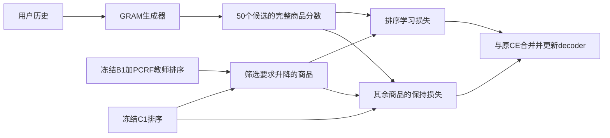

# 排序迁移：别人怎么做、我们怎么借鉴、下一版怎么验证

**2026-09-16综合修订：** 本文R0/R1/R2是尚未实施的候选，不能将后续KL/L0止损记作它们的实验失败。Q0未支持全局父保持项压制，因此下文R2优先建议已后置；R0/R1保留为有条件迁移备选。公式分析和文献记录保留，当前与条件参照新候选的统一顺序见[综合方法计划](../../plan/第二十阶段/论文主线与九月底方法冻结计划_20260916.md)。

## Material Passport

- 日期：2026-09-15；针对阶段20现有结果的定向文献研究与方法建议。
- Origin Skill：academic-research-suite / deep-research，单会话执行。
- 证据范围：9篇论文的方法部分、2篇新预印本的摘要筛查；另核对1篇跨任务选择性蒸馏论文的摘要。具体阅读深度见第2节。
- 本地依据：阶段20冻结计划、B1/B2双域报告、当前完整列表蒸馏代码及FIT缓存；历史PCPS等报告用于识别重复路线。
- 本文中的新方案是可实施的研究假设，尚未实现或训练；文献机制已经存在的部分明确归属原工作。没有完成穷尽查新，也没有确认可发表的新颖性。
- 本次新增计算仅为CPU NumPy缓存分析，无模型前向、无优化器更新、无新validation/test读取。运行中的恢复实验保持原配置。
- 人工阅读状态：本文不代表用户本人已经阅读这些论文。

## 1. 先用直白的话说结论

**下一版优先试：让GRAM重点学习强排序器要求改动的商品顺序，并对其余商品保留原模型的约束。**

例子：GRAM把玩具车排第20、积木排第7；B1＋PCRF把玩具车排第3、积木排第18。我们让GRAM学习“玩具车应在积木前面”。对教师没有要求跨越Top10边界的商品，则尽量维持原模型的相对偏好。这里的“纠错”指教师提出的修正请求，不表示每次修正都符合真实用户偏好。

这条路线可以组合三件已有基础：

1. 你已经得到的B1＋PCRF，提供目前较强的商品排序。
2. 文献中的完整商品排序学习，把教师偏好教给生成器。
3. 文献中的分歧筛选，集中处理教师和原模型意见不同的部分。

**我们要检验的额外设计是：原模型的保持约束，是否也应跟随这些修改位置而调整。** 它与前两项的组合有明确实现方式，但有效性和新颖性均待验证。

当前B1三个残差初始化均值的NDCG@10，相对复现GRAM在Toys/Beauty约为+8.01%/+8.73%，相对原PCRF为+4.65%/+4.09%；B1相对B0的新增提升为+1.35%/+2.27%。这说明已有排序平台值得利用，不代表生成器已经学会这些收益，也不是三个完整GRAM重训结果。[本地B1结果](Stage20_B1缓存复用多初始化验证进展与结果.md)

## 2. 别人怎么做，哪些值得拿来用

以下比较方法位置和迁移条件，不横比论文中不同数据划分的指标。

| 工作与阅读深度 | 原本解决什么问题、放在哪里 | 可以借鉴什么 | 与当前项目的距离 |
|---|---|---|---|
| [LOHRec，Findings EMNLP 2025](https://aclanthology.org/2025.findings-emnlp.977.pdf)，第3节及实验设置 | 给轻量生成推荐模型提供大模型的商品顺序和标识符分布监督；训练时加入完整商品排序目标，也讨论生成与排序的组合 | 用生成路径的完整商品分数学习教师顺序 | 最近的生成学生参照。完整商品排序蒸馏已经存在；我们只有外部融合商品分数，不能直接复制其生成教师的token分布 |
| [DCD，CIKM 2021](https://arxiv.org/html/2109.03459v4)，第2节 | 普通排序蒸馏没有充分关注学生错误；根据师生排名差选择被学生低估和高估的对象，学习用户侧及商品侧排序 | 学习教师要求升高与降低的商品之间的关系 | “只学分歧／重点纠错”不是我们的原创。首版冻结父模型分歧、只做用户侧，也不等于完整复现DCD |
| [DLLM2Rec，2024](https://arxiv.org/html/2405.00338v2)，第3节重点3.2.1 | 大模型的知识并非都适合小序列推荐器；排序蒸馏按位置、置信度、一致性加权，另做嵌入迁移 | 先筛选值得传递的教师信息，而不是假定所有输出一样可靠 | 其学生主要为传统序列推荐器，迁移方向与我们不同；其描述嵌入置信度不能直接套在B1上 |
| [HetComp，WWW 2023](https://www.microsoft.com/en-us/research/wp-content/uploads/2023/03/HetComp-CR.pdf)，第3.3、4节 | 异构教师即使更强，也可能更难学；利用教师训练轨迹和由易到难的排序目标 | 若强教师一直学不动，比较更易学习的中间目标 | 完整复现需要教师中间检查点。仅把蒸馏权重逐渐调大，不等于实现了HetComp |
| [SmartGR，2026-08预印本](https://arxiv.org/html/2608.02048v1)，第1—3节 | 生成教师向生成学生迁移时，考虑SID深度和累计前缀排序；从教师beam中选与目标共享前缀的路径 | 学到完整商品排名后，进一步检查前缀是否会在搜索中被淘汰 | 已有beam-aware蒸馏。其教师能给token／前缀概率；B1融合器不能直接提供同类监督 |
| [APAO，2026](https://arxiv.org/html/2603.02730v4)，第3—4.3节 | 只优化完整目标路径与逐步搜索存在差距；训练累计前缀的正负偏好，并自适应关注薄弱深度 | 若本轮证明确有搜索损失，借鉴累计前缀损失 | 累计前缀和薄弱深度加权已有先例；不能把旧PCPS改个权重当作新方法 |
| [BEAR，2026](https://arxiv.org/html/2601.22925v3)，第3节 | 用较便宜的局部必要条件缓解beam搜索淘汰：关注目标下一token在当前父前缀下的排名 | 借鉴训练与搜索匹配的分析方式 | 局部子节点排名并不完整覆盖跨父前缀竞争；GRAM的分支规模与原论文不同，不能直接照搬其失败比例 |
| [EAGER，2024](https://arxiv.org/html/2406.14017v2)，第3.3—3.5节 | 行为与语义两路编码、双生成通路，通过对齐与辅助任务融合两种知识 | 若转向结构改造，可借鉴两种信息在生成前／生成中相互帮助 | 需要新编码与双通路等实质改动；不是在现有两个分数后加一个门控就复现了它 |
| [PRORec，2025](https://arxiv.org/html/2502.06269v1)，第3.3—3.4节 | 先对齐协同与语义信息、形成统一编码，再用于生成训练和蒸馏 | 更上游地融合协同与语义知识 | 涉及编码和骨干重训，投入高于利用现成教师修改训练目标 |

补充摘要筛查：

- [DIG，2026预印本](https://arxiv.org/abs/2605.14853)：从tokenizer角度统一判别排序和生成检索，并包含判别到生成的迁移。仅凭“把判别知识放进生成器”不能主张首次提出；本文未做其公式级复现设计。
- [OxygenREC-v2，2026预印本](https://arxiv.org/abs/2607.24255)：包含行为条件生成与轨迹自蒸馏。其多行为工业数据设置与当前Amazon实验不同，本文只作方向重合筛查。
- [BinSKD，ACL 2026](https://aclanthology.org/2026.acl-long.1193/)：在二进制代码相似性检索中结合选择性蒸馏与分歧采样。任务不同，但进一步说明“有选择地融合教师优势”不是一个尚无人提出的通用概念。本轮核对摘要，未纳入推荐主对照。

### 从这些论文得到的具体判断

- **首选借鉴：LOHRec的商品顺序监督＋DCD的分歧选择。** 现有缓存和评分代码能够支持这条路线，额外工程相对明确。[LOHRec](https://aclanthology.org/2025.findings-emnlp.977.pdf)、[DCD](https://arxiv.org/html/2109.03459v4)
- **第二顺位：SmartGR／APAO的前缀训练。** 只有在本轮模型确实表现为“固定列表排序改善，但重新生成没有兑现”时，才优先投入这个分支。[SmartGR](https://arxiv.org/html/2608.02048v1)、[APAO](https://arxiv.org/html/2603.02730v4)
- **更大改造备选：EAGER／PRORec式信息融合。** 允许继续探索，但在已有强教师、两个月希望形成论文的条件下，我判断先利用现成部件更容易较快得到明确实验结论。这是工程投入判断，不是断言它们效果较差。[EAGER](https://arxiv.org/html/2406.14017v2)、[PRORec](https://arxiv.org/html/2502.06269v1)

## 3. 为什么这次建议与现有代码有关系

### 3.1 当前两个保持／蒸馏目标在数学上会折中

当前covered训练样本的损失为：

`CE + a × KL(p0 || pθ) + b × KL(q || pθ)`

这里p0是冻结C1在同一50候选上的分布，q是B1＋PCRF教师分布，pθ是学生分布。配置a=1；b经过覆盖数归一化后为`0.1 × 21839 / 12399 = 0.176135`。当前温度为1。

两个KL项可精确改写为：

`(a+b) × KL(m || pθ) + 与学生无关的常数`

其中`m = (a p0 + b q)/(a+b)`。因此，仅这两项的目标混合中，父模型占约85.02%，外部教师占约14.98%。实现位置：[list_loss](../../experiment/phase20/gacr_list_distill_core.py#L68)、[sample_backward](../../experiment/phase20/gacr_list_distill_core.py#L83)。

这解释了一个可能的阻力：教师希望改变的地方，也同时受到保持旧分布的约束。**它不是本轮失败的证据，不意味着学生一定学不好，也不表示教师只占总训练梯度的15%。** CE、共享参数、分数标准化和实际优化路径均不包含在这个简单解释里。初始学生等于父模型时，父模型KL梯度还可能为零。

CPU核验了上述等式及logit梯度等式，最大绝对误差分别约`8.88e-16`、`1.67e-16`。[计算脚本](../../artifacts/phase20/review_20260915/analyze_auxiliary_targets.py)、[诊断数据](../../artifacts/phase20/review_20260915/auxiliary_target_diagnostic.json)

### 3.2 教师具体要求改哪些位置，可以直接从现有缓存提取

在当前FIT缓存中，每个前缀的教师Top10相对父模型Top10，平均换入约3.44件商品；在可用教师监督的covered前缀上，平均换入约3.34件。按照“换入商品×换出商品”构造升降关系，covered前缀平均约12.63对。

这说明可以定义一个具体的局部改动范围，不必先训练一个新的门控网络。**分歧数量不等于正确修正数量，教师在这些FIT样本上训练过，不能用这些数字声称泛化有效。** 同时，保留50候选保持损失时仍需打分50个商品，不能根据关系数减少就宣称模型前向加速。[同一诊断数据](../../artifacts/phase20/review_20260915/auxiliary_target_diagnostic.json)

作为目标分布的描述，父模型、外部教师、两KL隐含混合目标在FIT的NDCG@10依次为0.22920、0.34477、0.25268。**第三项是人为计算的目标排序，不是训练后学生结果，也不是学生性能上限。** 正式评估仍以新beam生成结果为准。

## 4. 下一版加什么、放在哪里

### 4.1 位置：训练时，完整商品分数之后

三个训练部件：

| 部件 | 输入与输出 | 想解决的问题 | 来源与状态 |
|---|---|---|---|
| 排序修正选择器 | 父模型与教师的Top10集合→需要上升、下降的商品 | 将有限监督集中到影响前排结果的分歧 | 借鉴DCD；首版是固定集合运算，无可学习参数 |
| 完整商品顺序损失 | 升降商品的完整路径分数→排序惩罚 | 让生成器学会教师的相对顺序，减少依赖教师分数的具体标度 | 借鉴排序蒸馏；不是新损失类别 |
| 按修改范围设置的保持损失 | 未被选为升降对象的候选→父模型相对分布约束 | 减少同一位置既被要求改动又被要求保持的拉扯 | 本轮拟检验的设计；尚未证明收益或新颖性 |

推理时由更新后的GRAM正常生成。研究必须同时报告生成器自身结果及接原PCRF后的结果；不把“零额外推理开销”当作必须满足的投稿条件。首版沿用现有decoder训练范围，使不同训练目标可比较。

### 4.2 最小可实现定义

对每个已有的50候选集合C，固定K=10：

- `U = Top10(teacher) − Top10(parent)`：教师想提进前十的商品。
- `D = Top10(parent) − Top10(teacher)`：教师想移出前十的商品。
- `E = U ∪ D`；`A = C − E`。
- 对每个`i∈U, j∈D`，学习`i`应排在`j`之前：`Lrank = mean softplus((zθ(j)−zθ(i))/τ)`。
- `zθ`沿用当前50商品分数标准化；首版τ=1。先固定分歧于初始父模型，避免把动态候选更新一起引入。
- 保持项候选：把父模型与学生的50项分布分别限制到A并重新归一化，计算`KL(p0(.|A) || pθ(.|A))`。
- 总损失：原CE＋加权排序项＋保持项。
- 若U/D为空，使用原完整保持项，不额外加入排序项；若目标不在当前候选中，首版继续采用现有CE＋完整保持项。

上述集合至少保留30件商品在A中；实际FIT最少34件。当前未covered的9,440/21,839个前缀没有教师排序训练，此定义也没有解决候选缺失问题。若以后要扩大候选来源，应单独设计实验。

**这一保持项只约束A内部的相对分布。** 它不保证A总概率质量、A与E之间的顺序、或重新生成的候选覆盖保持不变；全列表标准化与共享参数也会产生耦合。比如E中的多个商品一起被抬高，仍可能挤掉A中的好商品。因此“其他部分保持稳定”是设计目的，需要实测，不能写成数学保证。

### 4.3 代码落点与隔离方式

- 复用现有冻结缓存、完整商品评分、chunk梯度回放和fresh beam评估思路。
- 新建独立的实验代码／配置实现选择器和损失，不改动恢复实验绑定hash的源文件。
- 分歧选择只使用训练候选、父模型分数和教师分数；不使用validation/test真值确定应相信谁。
- 各臂从同一C1开始，沿用同一21,839前缀、171步、训练顺序、batch、学习率、decoder参数范围和fixed-last选模。
- softplus和KL的数值／梯度尺度不同，不能因为旧教师权重是0.1就直接复制并宣称比较公平。先在固定训练样本上，以R1的排序项对商品分数的初始梯度范数匹配现有加权教师项，得到一个共同系数并固定；记录R0的实际尺度差异，保留各臂实际参数梯度和clipping比例诊断。这个做法不保证三臂梯度相同，也不能保证全程等强。
- 三个新臂采用相同排序项系数；选择性保持臂与对应完整保持臂仅改保持范围。后续使用弱完整保持、随机等大小掩码来排除“只是减弱正则”的解释。

## 5. 跑哪些对照，才能知道有没有用

### 第一批：三个新臂，回答两个问题

当前CE保持、完整列表KL真教师、打乱教师继续完成，提供已有参照。新臂需要独立实施和运行；本次尚未启动。

| 新臂 | 学哪些教师关系 | 保持哪里 | 比较回答什么 |
|---|---|---|---|
| R0：普通排序学习 | 教师Top10中的商品相对教师排名更低的所有商品，50候选内共445对 | 全50项 | 商品顺序监督是否比当前概率KL更适合 |
| R1：集中学习升降关系 | 上述U×D关系 | 全50项 | R1−R0检验关系选择的实际价值 |
| R2：升降关系＋局部保持 | 同R1 | A内部相对分布 | R2−R1检验调整保持范围的价值 |

各臂对自身有效关系取平均，使用同一种softplus形式。R0、R1是借鉴思想的匹配改编，**不是完整复现LOHRec或DCD**。关系数量与难度仍不同，所以若R1胜出，需补“同数量普通教师关系”对照后，才能把收益明确归于选择方式。

R2是推荐的候选组合，R0/R1用于说明组合中的哪一部分有帮助。并行运行取决于资源；不自动向当前队列追加新任务。按现有8样本profile粗估，每臂训练约4.5小时、评估约2.5小时，三臂约21 GPU小时，尚未计入新实现开销及资源等待；实际启动前需重新profile，不能视作完工承诺。

### 若第一批有收益，再补最有辨别力的对照

1. **R2 vs 减弱完整保持项**：排除整体约束变弱就足够的解释。初始父模型保持梯度为零，不能用初始梯度比直接求弱化系数；需预先固定小范围或用训练中的固定诊断点设定规则。
2. **R2 vs 相同大小的随机保持掩码**：排序关系仍用同一U×D，只随机改变保持哪些商品，检验“保持位置与修正位置配合”是否重要。
3. **R1 vs 同对数普通关系采样**：尽量控制关系数量，避免把简单减少关系误解为分歧筛选优势。
4. **真教师 vs 打乱教师**：用新方法自身的匹配打乱对照，不能直接拿旧KL的打乱臂代替。
5. 固定候选方案后在Beauty匹配验证、做必要训练重复，再使用独立test确认。若主张优于具体论文，则增加其可比实现，不能把“受其启发的简化版本”冒充原方法。

### 所有结果都必须回答这四件事

- 生成器自身在fresh beam50上，NDCG@10/Hit@10是否超过同起点C1和匹配继续训练对照？也列出复现GRAM这一外部基准。
- 接PCRF后的效果与原PCRF、C1＋PCRF、B1强参考相比怎样？不能只挑较弱参照。
- Hit@50、低频商品、原C1训练用户内外的结果怎样？允许指标之间有取舍，但要完整报告。
- 固定旧候选上的商品排序改善，有多少兑现成重新生成的收益？这是额外的评分评估，现有队列没有默认包含这项，不能把教师缓存指标冒充学生结果。

同时记录同一批用户上Top10新增命中／丢失命中、教师要求升降关系的满足率、未修改集合内部的排序变化，以及训练／推理成本。关系满足率只证明跟随教师的程度，不等于真实推荐效果。训练数据中的多个前缀按用户相关性处理；重复查看的validation用于探索，不能包装为未接触的最终检验。

## 6. 怎么与已有论文拉开差距

### 已经可以明确归为借鉴的部分

- 教师完整商品排序监督：LOHRec等已有。[来源](https://aclanthology.org/2025.findings-emnlp.977.pdf)
- 根据师生分歧集中教学：DCD等已有。[来源](https://arxiv.org/html/2109.03459v4)
- 置信度、选择性蒸馏、课程学习：DLLM2Rec、HetComp已有相关设计。[来源一](https://arxiv.org/html/2405.00338v2)、[来源二](https://www.microsoft.com/en-us/research/wp-content/uploads/2023/03/HetComp-CR.pdf)
- 考虑层级、前缀、beam搜索：SmartGR、APAO、BEAR已有。[来源一](https://arxiv.org/html/2608.02048v1)、[来源二](https://arxiv.org/html/2603.02730v4)、[来源三](https://arxiv.org/html/2601.22925v3)

### 值得争取的差异，需要实验支持

暂定研究问题：**外部排序器要求修正生成器的前排结果时，按修改位置调整原模型的保持约束，能否提高排序收益的迁移，并减少原有生成能力的损失？**

形成贡献至少需要连续三层证据：

1. **问题确实存在**：当前模型的完整保持约束与有价值的教师改动存在可测的折中，而不只是根据损失公式猜测；对训练不足、权重尺度等简单解释做必要控制。
2. **针对性处理优于简单做法**：优于普通排序蒸馏、DCD式关系选择，并优于简单减弱保持／随机改保持位置。单独换教师类型、换数据集或多加一个损失不足以说明这一点。
3. **改进落到真实任务**：至少Toys、Beauty的新beam生成和独立确认结果支持，不仅是旧候选排序更好；完整报告收益与覆盖／成本的取舍。

如果只是R0改善，结论是已有排序蒸馏思想适合当前任务，应先保留有效配置；不能硬说R2是核心贡献。如果R2只有Toys单种子小幅提升，也还不足以证明可发表性。若R2的作用能被减弱完整保持完全解释，应简化方案并放弃该机制的强主张。

**当前查新结论是“组合待检验，独立新颖性未确认”。** 这一轮检索不支持“首次”“此前无人研究”等措辞。可以先做有限实验，不要求提前保证原创；但投稿前必须扩大到选择性保持、知识编辑／持续学习中的修改与保留约束等相邻工作。

## 7. 另外两条路线什么时候转入

### 7.1 固定列表已经学会，但生成时仍掉结果

优先用当前学生的小批实际搜索轨迹，区分完整分数偏好、累计前缀竞争、候选缺失。若证明确有前缀淘汰，再对照SmartGR/APAO设计累计前缀监督。[SmartGR](https://arxiv.org/html/2608.02048v1)、[APAO](https://arxiv.org/html/2603.02730v4)

B1只有最终商品分数。把候选商品的教师概率按共享前缀相加，可以构造某种候选条件下的前缀偏好，但它不等于完整目录上的教师条件概率，且受候选截断影响。不能直接称为复现SmartGR；需要明确共享前缀、EOS、跨父前缀比较和候选外质量的处理。

旧PCPS主要比较同父节点下的下一token，辅以完整路径项；其教师与打乱对照未建立优势。旧100人轨迹中的跨父竞争结果来自不同模型／协议，不能当作当前失败定位。因此这次若做前缀方向，应是由新证据支持的具体改造。[历史结果与边界](Stage20_GACR_PCRF双域结果与提点路线_20260912.md)

### 7.2 简单的商品排序迁移仍持续无效

如果匹配排序目标和保持调整都没有建立收益，才把资源重点移到更上游的协同／语义融合，或调整生成骨干与可训练位置。EAGER和PRORec提供结构参照；它们不是不允许尝试，而是成本更大，当前不能宣称比利用现成教师更有把握。[EAGER](https://arxiv.org/html/2406.14017v2)、[PRORec](https://arxiv.org/html/2502.06269v1)

也不能把旧阶段某个adapter没有进入正式beam评估，解释成所有内部结构融合都已失败。阶段20的S-DPO崩溃、SPRec局部负结果则使这两条路线暂不优先重开。

## 8. 当前交付与下一步

本次已完成：文献机制对照、借鉴与查新边界、下一版部件位置和损失定义、三个主要实验臂及必要控制、CPU目标分析及可复算记录。

现在应推进的是这一份具体候选方案的实现准备，而不是继续没有范围地堆模块。当前恢复实验先给出完整KL的参照结果；后续是否执行R0/R1/R2、是否优先做Beauty确认，应结合其完整结果，但这不妨碍今天先完成方法设计。

两个月内投稿的关键里程碑仍是9月底前得到可重复的主线信号。本文没有新增学生实验结果，也没有证据保证CCF-B录用。

## 附：检索与本地证据记录

- 时间：截至2026-09-15；范围为生成推荐排序迁移、教师选择、前缀搜索优化，以及协同／语义融合。
- 检索包括论文题名查询和以下主题查询：`recommendation ranking distillation selective preservation teacher student disagreement knowledge distillation regularization`、`generative recommendation selective distillation anchor forgetting ranking correction`。
- 主要使用ACL官方论文、作者PDF和arXiv原文；搜索摘要用于定位，方法判断以所列方法节为准。9篇主表论文为定向方法阅读，不代表逐页审计全部推导与实验。DIG、OxygenREC-v2、BinSKD仅摘要级筛查。
- 新缓存诊断输入SHA256：`24529b6838df36992a7c6e9d5b0780e8a0bb23765abb162f08e9d093b867eda3`；验证读取前后hash不变、FIT计数、概率归一、加权KL与梯度等式、集合大小恒等式。
- 前一份[训练教师诊断](蒸馏运行期间的教师诊断与方法对照_20260915.md)记录原始教师FIT表现和学生评估模板；本文进一步给出文献适配与新方案，不覆盖旧记录。
- [当前冻结实验计划](../../plan/第二十阶段/Toys完整候选列表内部蒸馏实验计划.md)、[既有一周决策计划](../../plan/第二十阶段/方法主线与一周决策建议_20260915.md)、[完整列表训练核心](../../experiment/phase20/gacr_list_distill_core.py)。
